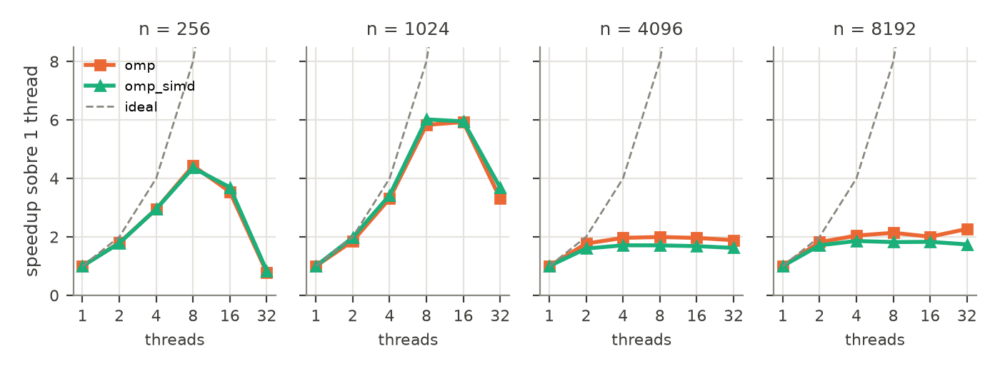
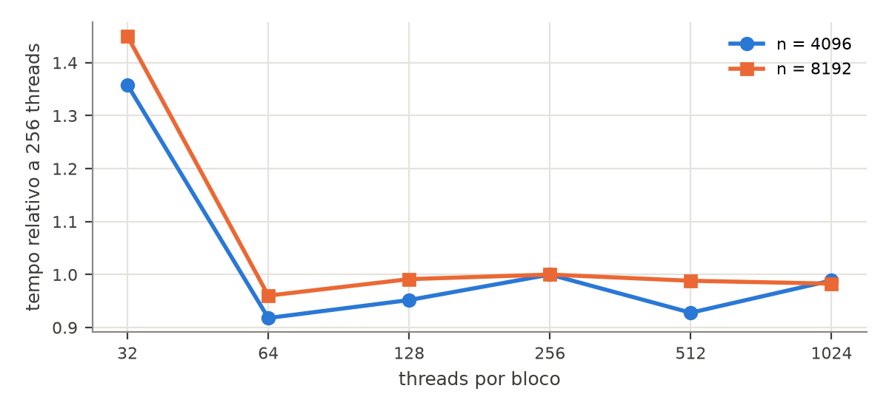

# Método de Jacobi para a equação de Laplace em 2D

Álvaro Augusto Costa - 246909\
_Instituto de Computação - UNICAMP_\
2026-11-10

---

## 1. Problema e implementações

O programa resolve a equação de Laplace em uma grade quadrada de ordem *n* pelo método de Jacobi. A cada iteração, cada ponto interior recebe a média dos quatro vizinhos da iteração anterior, e as bordas permanecem fixas:

$$u^{(k+1)}_{i,j} = \tfrac{1}{4}\left(u^{(k)}_{i-1,j} + u^{(k)}_{i+1,j} + u^{(k)}_{i,j+1} + u^{(k)}_{i,j-1}\right)$$

A execução termina quando a maior variação entre duas iterações é menor que $\varepsilon$ ou quando se atinge o número máximo de iterações. A grade inicial tem valores uniformes em [0, 1), gerados a partir de uma semente fixa. Os elementos são representados em ponto flutuante de 32 bits (tipo `float`).

| Versão | Estratégia |
|---|---|
| `serial` | Laço duplo sequencial, com dois buffers trocados a cada iteração |
| `omp` | `parallel for` no laço de linhas, `schedule(static)` e `reduction(max:diff)` |
| `omp_simd` | Como `omp`, com `omp simd` no laço de colunas e `-march=native` |
| `cuda` | Uma thread por célula, tamanho de bloco configurável (`-b`) e uma flag global que indica se alguma célula ainda varia mais que $\varepsilon$ |

Na versão CUDA, a flag substitui a redução de máximo: a execução converge quando nenhuma célula a marca, o que equivale ao critério `max(diff) < epsilon` das versões de CPU.

## 2. Ambiente e metodologia

- Nó n18: CPU Intel Xeon E5-2630 v3; 32 GB RAM; GPU NVIDIA Tesla K40c; Clang 21, CUDA 11.8.
- Compilação em modo Release (`-O3`).
- Medições com `scripts/benchmark.py`: 500 iterações com $\varepsilon = 0$ (todas as iterações são executadas), $n \in \{256, 1024, 4096, 8192\}$, 1 a 32 threads nas versões OpenMP e blocos de 32 a 1024 threads na versão CUDA. Cada configuração foi executada 5 vezes, em ordem aleatória, e os valores reportados são medianas (arquivo `results/benchmark_20261110_201058.csv`). Execuções anteriores com 100 e 1000 iterações foram usadas na seção 4.4.
- O tempo medido exclui a geração da grade. Na versão CUDA, inclui a inicialização do contexto, a alocação e as transferências entre CPU e GPU.
- O coeficiente de variação entre repetições chegou a 22% para n = 256, cujas execuções duram centésimos de segundo, e a 13% para $n \geq 4096$. Nas versões OpenMP com n = 8192, a mesma configuração levou de 25 a 35 s; em uma execução anterior com os mesmos parâmetros essa variação ficou abaixo de 1%, e as medianas das duas execuções diferem em até 10%.

## 3. Validação

Cada versão paralela é executada com a mesma semente e o mesmo número de iterações que a versão sequencial. A matriz final é gravada em arquivo (opção `-o`) e comparada elemento a elemento com a sequencial por `scripts/compare.py`:

- erro absoluto: $e_{abs} = \max_{i,j} \left|x^{par}_{i,j} - x^{seq}_{i,j}\right|$
- erro relativo: $e_{rel} = \max_{i,j} \left|x^{par}_{i,j} - x^{seq}_{i,j}\right| / \left|x^{seq}_{i,j}\right|$

Um resultado é aceito se $\left|x^{par}_{i,j} - x^{seq}_{i,j}\right| \le 10^{-5}$ para todos os elementos e o número de iterações for o mesmo. Como os valores estão em [0, 1], a tolerância é cerca de 100 vezes a precisão de `float` ($1{,}2 \times 10^{-7}$).

| Versão | Casos testados | Maior $e_{abs}$ | Maior $e_{rel}$ |
|---|---|---:|---:|
| `omp` | n de 256 a 8192, 1 a 32 threads | 0 | 0 |
| `omp_simd` | n de 256 a 8192, 1 a 32 threads | 0 | 0 |
| `cuda` | n de 256 a 8192, blocos de 32 a 1024 threads | 0 | 0 |

As 72 comparações foram feitas no n18 com as matrizes das execuções de desempenho (500 iterações, $\varepsilon = 0$). Em todas, a matriz final é idêntica bit a bit à da versão sequencial, inclusive na GPU. Isso acontece porque todas as versões fazem as mesmas operações de ponto flutuante na mesma ordem: cada célula é calculada de forma independente e a soma dos vizinhos segue a mesma ordem.

## 4. Desempenho

### 4.1 Tempo de execução e speedup

{width=70%}

| n | omp | omp_simd | cuda | cuda / melhor CPU |
|---:|---:|---:|---:|---:|
| 256 | 3,9 | 4,2 | 0,36 | 0,09 |
| 1024 | 5,4 | 6,0 | 5,8 | 0,97 |
| 4096 | 1,7 | 1,8 | 27,8 | 15,8 |
| 8192 | 2,0 | 1,9 | 37,9 | 18,8 |

: Speedup em relação à versão sequencial.

### 4.2 Escalabilidade com o tamanho da matriz

A versão sequencial gasta de 1,6 a 1,8 ns por célula e iteração em todos os tamanhos. As versões OpenMP chegam a 0,26 ns em n = 1024, mas sobem para 0,9 a 1,0 ns em $n \geq 4096$. Em n = 1024 as duas matrizes ocupam 8 MB e cabem no cache L3 do processador. Em $n \geq 4096$ ocupam 128 MB ou mais e não cabem na cache, então cada iteração passa a ler e escrever na memória principal. Na versão CUDA, o tempo por célula cai com o aumento de n, pois um custo fixo é dividido por mais trabalho (seção 4.4).

### 4.3 Escalabilidade OpenMP com o número de threads

- Em n = 1024 os dados cabem na cache e o speedup chega a 6,0 com 8 threads (eficiência de 75%).
- Em $n \geq 4096$ o speedup para em cerca de 2 a partir de 4 threads. A largura de banda efetiva é de 8 a 14 GB/s, o que indica que a memória é o limite.
- Em n = 256 há pouco trabalho por iteração, e a sincronização entre threads limita o speedup a 4,4 com 8 threads (eficiência de 55%).
- O processador tem um soquete com 8 núcleos e 16 threads de hardware. Com 16 threads, cada núcleo executa duas threads (*hyper-threading*), e com 32 há mais threads que o hardware suporta. Nesses casos o desempenho não melhora de forma consistente e piora em n = 256 e n = 1024.
- A vetorização (`omp_simd`) ganhou no máximo 12% no n18, em n = 1024. Para $n \geq 4096$ não há ganho, porque o gargalo é a memória.

### 4.4 Versão CUDA

O tempo da versão CUDA tem três partes: a inicialização do contexto CUDA, as cópias da grade entre CPU e GPU (duas na ida, uma na volta) e as iterações do kernel. Comparando execuções do mesmo kernel com 100 e 1000 iterações, a parte que não depende do número de iterações é de 0,29 s em n = 8192. Desse total, cerca de 0,12 s é a inicialização (o tempo total em n = 256) e cerca de 0,17 s são as cópias, que transferem 768 MB a aproximadamente 5 GB/s. Esse custo explica por que a GPU só alcança a CPU em n = 1024 e perde em n = 256.

Descontado esse custo, cada iteração em n = 8192 leva 2,5 ms com blocos de 256 threads. Como o kernel lê e escreve 8 bytes por célula, isso equivale a cerca de 211 GB/s, 73% do pico da K40c. O kernel faz poucas operações por byte lido e é limitado pela memória. Por iteração, ele é 23 vezes mais rápido que a melhor versão de CPU, valor próximo da razão entre as larguras de banda obtidas na GPU (211 GB/s) e na CPU (8 a 14 GB/s).

{width=70%}

Blocos de 32 threads são de 36% a 45% mais lentos. Na K40c, cada multiprocessador comporta no máximo 16 blocos e 2048 threads; com blocos de 32 threads há no máximo 512 threads ativas por multiprocessador, poucas para esconder a latência da memória. De 64 a 1024 threads os tempos ficam a menos de 9% uns dos outros, e 64 threads foi o melhor tamanho nos dois casos.

A tabela compara três versões do kernel, com blocos de 256 threads e n = 8192. O tempo por iteração foi estimado descontando os 0,29 s de custo fixo do tempo total.

| Kernel | Tempo por iteração | Largura de banda |
|---|---:|---:|
| Com `__restrict__`, limite `float` | 2,3 ms | 236 GB/s |
| Sem `__restrict__`, limite `double` | 3,1 ms | 173 GB/s |
| Com `__restrict__`, limite `double` (atual) | 2,5 ms | 211 GB/s |

Na arquitetura Kepler, `const` com `__restrict__` permite que o compilador leia a grade pelo cache de dados somente leitura (instrução `ld.global.nc`) [1], o que reduziu o tempo por iteração em cerca de 18%. A diferença restante, de cerca de 10%, vem da comparação em `double`, mas as duas primeiras linhas foram medidas com apenas 100 iterações, em que o custo fixo é metade do tempo total, e essa diferença está próxima da incerteza da estimativa.

### 4.5 Otimizações testadas na CPU

Antes da versão final, algumas alternativas foram medidas no laptop com 8 threads. São medições pontuais (melhor de 3 execuções) e parte do código não está no repositório.

| Alternativa | n = 1024 | n = 4096 |
|---|---:|---:|
| Laço de linhas, `schedule(static)` (versão `omp`) | 0,185 | 0,419 |
| Vetorização (versão `omp_simd`) | 0,043 | 0,416 |
| Blocagem temporal (16 iterações por bloco de 32 linhas) | 0,041 | 0,082 |

: Tempo por célula e iteração (ns).

O escalonamento estático no laço de linhas é adequado porque todas as linhas têm o mesmo custo. Em n = 1024, ele obteve speedup de 4,9 sobre a sequencial, contra 3,1 com `collapse(2)` e 2,0 com `schedule(dynamic,1)`. A vetorização só ajuda quando os dados estão na cache. A blocagem temporal, que avança várias iterações sobre um bloco de linhas antes de passar ao próximo, foi a única alternativa que reduziu o tráfego de memória em n = 4096 (5 vezes mais rápida). Ela foi descartada porque só permite verificar a convergência a cada 16 iterações e torna o código mais complexo.

### 4.6 Gargalos

- CPU, $n \geq 4096$: largura de banda da memória. O speedup fica em cerca de 2 e a vetorização não tem efeito.
- CPU, n pequeno: sincronização a cada iteração. Com 8 threads em n = 256, a eficiência é de 55%.
- GPU, $n \leq 1024$: inicialização do contexto CUDA (0,12 s), maior que o tempo de cálculo.
- GPU, todos os tamanhos: cópias entre CPU e GPU a cerca de 5 GB/s. Memória fixada (*pinned*) no host poderia acelerá-las, mas não foi testada.
- GPU, kernel: largura de banda da memória da GPU, com 73% do pico na versão atual. Blocos de 32 threads não ocupam o multiprocessador o suficiente.

## 5. Conclusão

As três versões paralelas reproduzem exatamente o resultado sequencial, inclusive na GPU. O paralelismo na CPU é eficiente enquanto a grade cabe na cache (speedup de 6,0 em n = 1024), mas para grades maiores fica limitado pela memória em cerca de 2. A GPU tem largura de banda bem maior e, com 500 iterações, é 19 vezes mais rápida que a melhor versão de CPU em n = 8192. Ela só compensa quando há trabalho suficiente para amortizar a inicialização e as cópias da grade. No kernel, o uso de `__restrict__` teve mais efeito que o tamanho do bloco, que importa pouco a partir de 64 threads.

## 6. Uso de Inteligência Artificial

Este relatório foi elaborado com o apoio do assistente Claude Code (modelo Claude Opus 5.5, Anthropic). A ferramenta foi usada para:

* criar o modelo do relatório;
* revisar e formatar o texto escrito;
* formatar tabelas a partir dos dados obtidos;
* criar script de geração dos gráficos;

O planejamento e a execução dos experimentos, assim como a coleta dos dados, foram feitos pelo autor. Todo o conteúdo gerado foi revisado pelo autor, que é responsável pelo texto final.

## Referências

[1] J. Appleyard. *CUDA Pro Tip: Optimize for Pointer Aliasing*. NVIDIA Technical Blog, 2014. Disponível em: <https://developer.nvidia.com/blog/cuda-pro-tip-optimize-pointer-aliasing/>.
